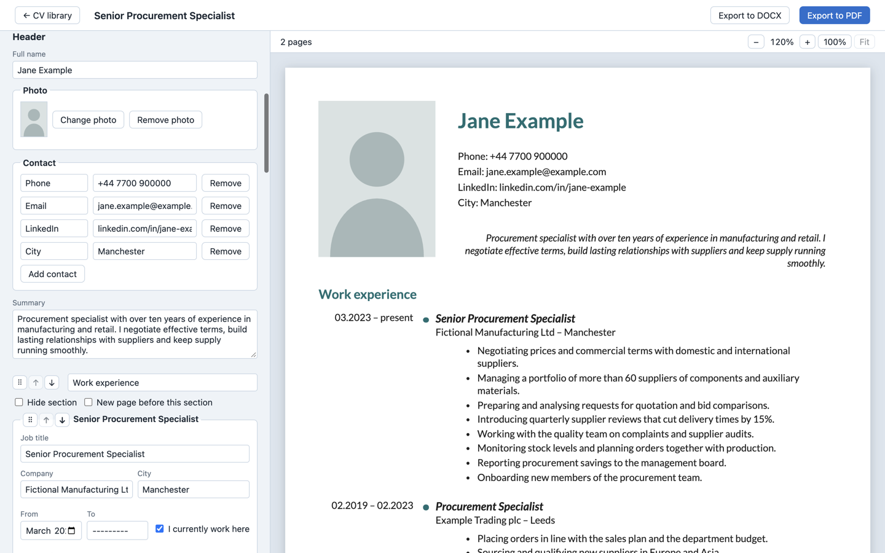

# CV Drawer

CV Drawer is a free Mac app for writing a CV with a live preview of its A4 pages. You fill in a form, pick a template, colours and fonts, and export the CV to PDF or to an editable DOCX for Word, Pages, LibreOffice or Google Docs. Everything stays on your Mac: no account, no cloud.



## Download

- **Mac App Store**: coming soon.
- **`.dmg`**: [latest release on GitHub](https://github.com/michalstaniecko/moje-cv/releases/latest), signed with a Developer ID and notarized by Apple.

Requires macOS 13 Ventura or later, on Apple Silicon or Intel. Both versions share the same CV library on your Mac.

## Privacy

CV Drawer doesn't collect, send or share the content of your CVs or any other personal data. Everything is stored locally on your Mac.

- The Mac App Store version doesn't connect to the network at all.
- The `.dmg` version asks GitHub for the number of the latest release, at most once a day and when you choose Help → Check for Updates…. The request carries no identifiers; GitHub sees only your IP address.

Full text: [Privacy Policy](https://ihumbak.website/cv-drawer/privacy/).

## Support

- [CV Drawer Help](https://ihumbak.website/cv-drawer/): installing, first launch, where your CVs are stored.
- [Report a problem or suggest a feature](https://github.com/michalstaniecko/moje-cv/issues/new/choose). Please include the version from CV Drawer → About CV Drawer. Issues are public, so don't attach your real CV.
- Security issues: see [SECURITY.md](SECURITY.md).

## Sponsor

CV Drawer is free and works the same whether or not you support it. If it helped you, you can say thanks through [GitHub Sponsors](https://github.com/sponsors/michalstaniecko).

## Development

Requires Node.js and [pnpm](https://pnpm.io/).

```sh
pnpm install
pnpm dev        # run the app with hot reload
pnpm test       # unit tests (Vitest)
pnpm test:e2e   # end-to-end tests (Playwright + Electron)
```

Building, signing and notarizing the `.dmg` and the Mac App Store build: [`docs/instalacja.md`](docs/instalacja.md) and [`docs/wydanie-mac-app-store.md`](docs/wydanie-mac-app-store.md) (in Polish). Domain vocabulary: [`GLOSSARY.md`](GLOSSARY.md); architecture decisions: [`docs/adr/`](docs/adr/).

## License

The source code is available under the [MIT License](LICENSE). The name “CV Drawer” and the app icon are not covered by the license: if you distribute a modified version, please give it a different name and icon.

The bundled fonts Lato, Source Sans 3 and Arimo keep their own license, the SIL Open Font License 1.1 (`resources/fonts/*/OFL.txt`).
